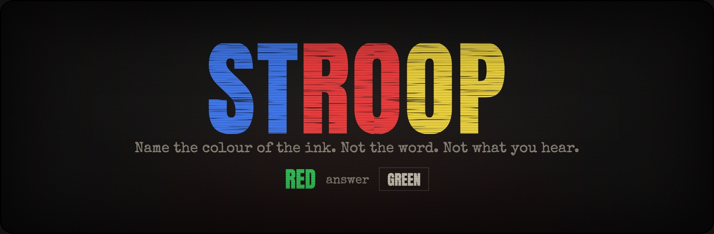

# Stroop



**Name the ink. Not the word. Not what you hear.**

A horror-styled reaction game built on the Stroop effect. A colour word flashes on screen, printed in an ink that usually doesn't match it. You have seconds to pick the ink while a voice reads the word aloud to pull you the wrong way. Pass each test to unlock the next. Pass the hardest one and a hidden mode opens.

It runs in the browser on desktop, tablet and phone, and plays best with headphones.

---

## The idea

In 1935 the psychologist John Ridley Stroop showed that people are slower and make more mistakes naming the ink of a word when the word names a different colour. Reading is so automatic that the brain reads **RED** before it registers the green ink, and then has to overrule itself. That delay is called the *Stroop effect*.

This game turns that delay into pressure:

- **Time limits** leave no room to second-guess.
- **A voice** reads the printed word aloud, adding a second wrong signal through your ears.
- **More colours** at higher levels mean more possible wrong answers.
- **In the last mode**, the answer buttons move and their labels are printed in misleading inks too.

The results page measures your own Stroop effect: how much slower you answered when the word and ink disagreed.

## How to play

1. When the page loads, choose **Turn on sound** (headphones recommended) or **Continue without sound**.
2. Pick a difficulty from the menu.
3. After a 3‑2‑1 countdown, a word appears, for example **GREEN** printed in red ink.
4. Press the button for the **ink colour**. Here that's **RED**, not GREEN.
5. Answer before the bar under the word runs out. The screen flashes and buzzes when you're wrong, and the correct ink is shown.
6. At the end you get an evaluation report: stamped **PASSED** or **FAILED**, with your stats.

About 15% of rounds are a trap the other way: the word *matches* its ink. You can't win by always rejecting the word; you have to actually look.

## Difficulties

| Mode | Colours | Rounds | Time per round | To pass | Unlocks after |
| --- | --- | --- | --- | --- | --- |
| **Easy** | 3 | 10 | 6 s | 7 / 10 | open from the start |
| **Normal** | 6 | 20 | 3 s | 15 / 20 | passing Easy |
| **Hard** | 9 | 20 | 3 s | 20 / 20 (no mistakes) | passing Normal |
| **Overload** | 9 | unlimited | 3 s | none: score as high as you can | passing Hard |

- Locked modes show what you need to pass to open them.
- **Overload doesn't appear on the menu at all** until you pass Hard.

### Overload

- **2 minutes on the clock**, no round limit. Your score is the number of correct answers.
- **Every wrong answer or timeout costs 3 seconds**, so guessing fast drains the clock.
- **The buttons swap places every round**, so you can't rely on muscle memory.
- **The button labels lie too.** Each label is printed in a different one of the nine inks, never its own.

### Colours

Easy uses red, blue and green. Normal adds yellow, purple and orange. Hard and Overload add pink, cyan and white.

## The results report

After each run you get a typed evaluation sheet:

| Field | What it means |
| --- | --- |
| Score | Correct answers (out of the round count, or in two minutes for Overload) |
| Accuracy | Share of rounds answered correctly |
| Best streak | Longest run of correct answers in a row |
| Avg reaction | Average time to a correct answer |
| Fastest | Your quickest correct answer |
| Wrong / too slow | Mistakes vs. rounds where time ran out |
| Word interference | How much slower you were when word and ink disagreed: your personal Stroop effect |
| Previous best | Shown if you've played this mode before |

A row of ✓ ✗ – marks shows every round in order. If the run unlocked a new mode, a note on the report says so, and the main button takes you straight into it.

Best scores and passed modes are saved on your device.

## The voice

Every round, a voice reads the **printed word**, never the ink. It's there to mislead you. Choose who reads from **Voice** on the menu:

| Voice | Accent |
| --- | --- |
| Samantha (default) | American English (en-US) |
| Tessa | South African English (en-ZA) |
| Moira | Irish English (en-IE) |
| Karen | Australian English (en-AU) |
| Daniel | British English (en-GB) |
| Fred | American English, classic synthesiser (en-US) |
| Custom | Any voice installed on your device, with pitch and speed sliders |

The game uses the browser's built-in speech, so the voices are the ones your device already has. These six are Apple system voices: they are present on Macs, iPhones and iPads, but not on Android or Windows. The voice form marks each one as "on this device" or "not on this device". When a voice is missing, the game uses the device's default voice instead, retuned in pitch and speed so the six options still sound different from each other. You can also change the volume or switch the voice off.

> The voices aren't bundled as audio files. Apple's licence for its system voices doesn't allow recording them for distribution. Making every device sound identical would need clips from a voice whose licence allows redistribution.

## Look and sound

The game is styled like found footage from an experiment you didn't sign up for.

- **Menu**: an old CRT television. The screen powers on with a bright line, scanlines roll over it, static bursts through now and then, and the picture tears and slips.
- **Gameplay**: a camcorder viewfinder, with corner brackets, a blinking ● REC and a timecode in Overload. The game screen is locked to exactly one screen height, so nothing shifts while you play.
- **Results**: a typed paper report with a rubber stamp.
- **Type**: scratched, heavy condensed lettering ([Anton](https://fonts.google.com/specimen/Anton)) for titles, the colour word and the buttons, and a worn typewriter face ([Special Elite](https://fonts.google.com/specimen/Special+Elite)) for everything else.

All audio is generated live in the browser. There are no sound files.

| Sound | When |
| --- | --- |
| Menu score | Starts the moment you pass the sound screen: a detuned drone, a broken music box that sometimes winds down, and scattered heartbeats, metal scrapes, distant clanks and breathing |
| Pass score | On the report after a pass or a new Overload record: a gentle, slightly wrong lullaby |
| Fail score | On the report after a fail: a chord that collapses, then a low hum and a slow heartbeat |
| Effects | Countdown beeps, a chime when you're right, an electric buzz when you're wrong, a pulse in the last 10 seconds of Overload |
| Ambience | A low fluorescent hum under gameplay |

## Controls

- **Mouse or touch**: tap an answer button.
- **Keyboard**: <kbd>1</kbd>–<kbd>9</kbd> pick the buttons in reading order (left to right, top to bottom). In Overload the order changes every round, so the keys follow the buttons.
- **Esc**: quit the current run, close a form, or leave the results page.

## Settings

Open **Settings** from the menu to switch on or off:

- **Music**, with a volume slider
- **Sound effects**
- **Ambience**

**Voice settings** and **Erase progress** are also there. Settings and progress are stored in your browser's `localStorage` (`stroop.settings.v1` and `stroop.progress.v1`), so they stay on that device.

If you chose **Continue without sound** on the opening screen, Settings shows a link to turn sound back on for that visit.

## Accessibility

- Every answer can be made from the keyboard.
- With sound off, the game is fully playable; feedback is also shown on screen.
- If your system asks for reduced motion, the CRT roll, static, tears, shake and flicker are switched off. The round timer still runs, because it's information rather than decoration.

---

## Running it

Requires Node.js 20 or newer.

```bash
npm install
npm run dev
```

Then open <http://localhost:3000>.

**On a phone or tablet:** connect it to the same Wi-Fi and open `http://<your computer's local IP>:3000`. `next.config.ts` allows private network addresses (`192.168.*.*`, `10.*.*.*`, `172.*.*.*`, `*.local`) for the dev server. Without that, Next.js blocks its development scripts and the page loads but never responds to taps.

**Production build:**

```bash
npm run build
npm start
```

## Built with

- [Next.js 16](https://nextjs.org) (App Router), React 19 and TypeScript. No other runtime dependencies.
- **Web Speech API** for the voice.
- **Web Audio API** for all music and sound effects, synthesised on the fly.
- Plain CSS for all visuals, including the scanlines, film grain and scratched type.

## Project layout

```
docs/
  banner.jpg           README header image
public/
  icons/               192/512 px and maskable app icons
src/
  app/
    layout.tsx         fonts and page metadata
    page.tsx           mounts the game
    globals.css        all styling
    favicon.ico        16/32/48 px favicon (the misprinted S)
    icon1.png          32 px tab icon
    icon2.png          192 px icon for phones
    apple-icon.png     iPhone/iPad home-screen icon
    manifest.webmanifest  web app manifest (Android home screen)
  components/
    StroopGame.tsx     screen flow, music, unlocks
    SoundGate.tsx      opening "turn on sound" screen
    Menu.tsx           CRT menu and mode list
    Game.tsx           the game loop and viewfinder
    Results.tsx        the evaluation report
    SettingsPanel.tsx  settings form
    SoundbotPanel.tsx  voice picker
  lib/
    difficulty.ts      modes, timings, goals, unlock chain
    colors.ts          the nine inks
    trial.ts           round generation and result stats
    soundbot.ts        voices and speech
    sfx.ts             sound effects and ambience
    bgm.ts             menu, pass and fail music
    narration.ts       result-page narrator (currently switched off)
    progress.ts        saved unlocks and best scores
    settings.ts        saved settings
```

## Tweaking the game

| To change | Edit |
| --- | --- |
| Rounds, timings, pass marks, penalties, unlock order | `src/lib/difficulty.ts` |
| How often the word matches its ink (`CONGRUENT_CHANCE`) | `src/lib/difficulty.ts` |
| Ink colours and the order they're added | `src/lib/colors.ts` |
| Voices and their tuning | `PERSONAS` in `src/lib/soundbot.ts` |
| Music | the scene functions in `src/lib/bgm.ts` |

### The results narrator (switched off)

The code includes a narrator who comments on each result. It speaks a line and prints it on the report under "Remarks", and the music dips while it talks. It is turned off for now while a final voice is chosen. To turn it back on, set `NARRATION_ENABLED = true` in `src/lib/narration.ts`; its lines are in the same file. Any recorded voice used for it must be audio you have the rights to.

## Credits

- Game concept: the Stroop colour-word test (J. R. Stroop, 1935).
- The atmosphere was inspired by Stroop-style puzzles in horror games such as *The Outlast Trials*. This is an independent project: it uses no names, characters, art, audio or other assets from that game.
- Fonts: Anton and Special Elite, both from Google Fonts under the SIL Open Font License.
